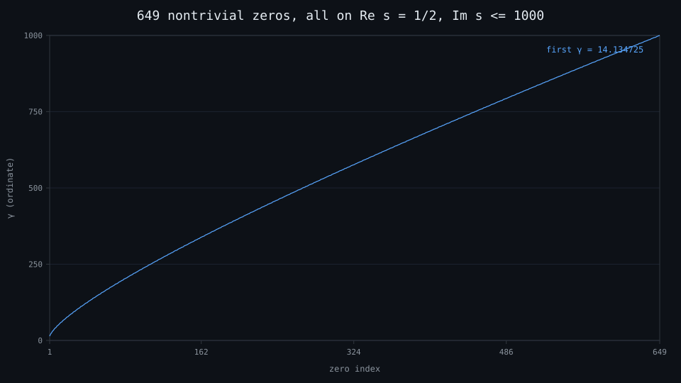
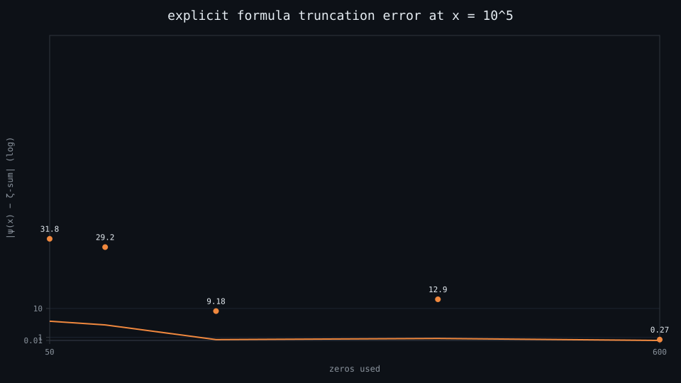

# zeta-edge — measured results

Generated from `out/*.json` on the machine that ran `pipeline.py` (total pipeline wall clock **279.4 s**).

Third-party verifier: exit code **0** (all checks passed), transcript in `out/verify_output.txt`.

## 1. Zeros of ζ on the critical line

| quantity | value |
| --- | --- |
| height | γ ≤ 1000 |
| zeros found | **649** |
| smooth count N(T) = θ(T)/π + 1 | 648.6162 |
| S(T) = N(T) − smooth | +0.3838 |
| max residual \|ζ(1/2+iγ)\| | 2.57e-11 |
| max \|Δγ\| vs published tables | 8.72e-12 |
| published-value check | PASS |



## 1b. Independent cross-check against mpmath

Every other check in this report compares this code to itself or to a table typed
in by hand. This one compares it to a separate, widely used implementation — the
only non-circular check here.

| check | result |
| --- | --- |
| zeros compared | 50 |
| max \|our γ − mpmath γ\| | 1.44e-11 |
| verdict | ordinal agreement with mpmath within 1e-9 |


mpmath's own ζ evaluated at our ordinates: max \|ζ\| = 1.90e-11, so an independent
implementation also finds zeros where we claim zeros.

Z(t) agreement at fixed points:

| t | ours | mpmath | \|diff\| |
| --- | --- | --- | --- |
| 14.1347 | 0.000000000002 | -0.000000000000 | 1.76e-12 |
| 100 | 2.692697056679 | 2.692697056664 | 1.49e-11 |
| 1000 | 0.997794637533 | 0.997794637522 | 1.16e-11 |
| 5000 | -0.804257236354 | -0.804257236353 | 1.39e-12 |

## 1c. The table-audit tool, run on this repo's own output

`zeta-audit` is the repo's practical entry point: point it at an opaque zero file
and get a verdict. Running it on our own table is the honest smoke test — if it
fails on output we produced, it is worthless on someone else's.

- target: `out/self_audit_input.txt (our own zero table)`
- all checks passed: **True**
- structural: True
- our max residual: 2.44e-11
- mpmath max residual: 2.39e-11
- independent max diff: 3.94e-12
- implied S(T): +0.552

## 2. RH verified in the strip (argument principle)

The count on the right does **not** assume RH: it is Δarg ζ / 2π around the rectangle
[0.1, 2] × [0.5, T], which counts zeros inside the region regardless of where they are.
Equality with the on-line count is therefore an actual verification.

| T | zeros on the line | zeros in strip [0.1,2]×[0.5,T] | match |
| --- | --- | --- | --- |
| 100 | 29 | 29 | yes |
| 300 | 138 | 138 | yes |
| 600 | 341 | 341 | yes |

Highest verified height: T = 600, i.e. every zero with 0.5 < Im s ≤ 600 lies on Re s = 1/2.

This is the check worth pointing at a published zero table: it is independent of the
producer's method, and it fails loudly if a table is wrong.

## 3. Error-bar audits (each bound conditional on RH — none is currently a theorem)

All four statements below are what RH *would* give; none is proved today. The audit
compares each against exact π(x)/ψ(x) on a finite range. The ratio column is
observed error / the bound's constant. Ratio < 1 on a finite range is **evidence about
tightness**, not a proof of the inequality.

| bound | range audited | worst ratio (error / bound) | holds |
| --- | --- | --- | --- |
| \|ψ(x) − x\| < √x log²x / 8π | 59 ≤ x ≤ 10,000,000 | 0.464 @ x=113 | yes |
| \|π(x) − li(x)\| < √x log x / 8π | 2657 ≤ x ≤ 2,000,000 | 0.964 @ x=2657 | yes |
| next prime gap < C√x log²x | x ≤ 10,000,000 | 0.227 @ x=1327 | yes |
| π(x) − R(x) inside bar | samples | 0.189 | yes |

Largest prime gap found: **154** after x = 4,652,353.

## 4. Explicit formula: the zeros *are* the error term

ψ(x) at x = 10⁵, reconstructed from the first k zeros (truth = 100051.564):

| zeros used | ψ(x) approx | error |
| --- | --- | --- |
| 50 | 100019.778 | -31.786 |
| 100 | 100022.378 | -29.186 |
| 200 | 100042.383 | -9.181 |
| 400 | 100038.697 | -12.867 |
| 600 | 100051.294 | -0.270 |



## 5. Conditional primality certificates (hypothesis: ERH/GRH, not RH)

Miller-Rabin is deterministic on n once no base in the set is a witness. The set
"all primes a <= 2 log^2 n" follows from the least-quadratic-nonresidue bound under
**ERH/GRH** (Bach 1990) — not from plain RH, which says nothing about Dirichlet
L-zeros. Every block prints the hypothesis, so the verdict cannot be read as an
unconditional proof. Below 3.317e24 the 13-base set makes it unconditional anyway.

This is the clearest demonstration of *why* such hypotheses matter; it is **not** a
faster primality test and not a commercial offering — see §8.

| bits | bases | base ceiling 2log²n | verdict |
| --- | --- | --- | --- |
| 65 | 546 | 3,936 | prime |
| 97 | 1,103 | 8,856 | prime |
| 129 | 1,836 | 15,743 | prime |
| 193 | 3,772 | 35,423 | prime |
| 257 | 6,316 | 62,974 | prime |
| 385 | 13,157 | 141,691 | prime |
| 521 | 22,899 | 260,829 | prime |

Next-prime demo from 10⁴⁰: **+121** after 61 candidates, 133 bits, certified `prime`.

Certifier throughput (single thread):

| bits | mean bases | mean candidates scanned | base ceiling |
| --- | --- | --- | --- |
| 64 | 542.2 | 17.0 | 3,814 |
| 96 | 1,090.2 | 44.8 | 8,672 |
| 128 | 1,820.5 | 70.0 | 15,498 |
| 192 | 3,755.5 | 38.0 | 35,055 |
| 256 | 6,305.0 | 71.8 | 62,483 |

## 6. Cost of an exhaustive proof (32 cores / 16 physical)

This section exists to quantify the negative result: how expensive the deterministic
sweep actually is, which is why no compliance regime would swap MR for it.

| bits | bases swept | verdict | wall clock | single-thread rate | sequential est. | speedup |
| --- | --- | --- | --- | --- | --- | --- |
| 512 | 22,186 | prime | 1.5 s | 2,836 modexp/s | 8 s | 5.4× |
| 1024 | 78,993 | prime | 11.0 s | 500 modexp/s | 158 s | 14.4× |

*Sequential estimate is measured, not assumed: the single-thread rate is timed on a
sample and multiplied by the base count.*

## 6b. Attestation wrapper (demonstration)

Demonstration only — see §8 for why this is not a product. Each row is a prime
with a scan record, a provable gap ceiling, a base list, and a chained log entry.

| requested bits | actual bits | gap from start | candidates scanned | bases | seq est. |
| --- | --- | --- | --- | --- | --- |
| 128 | 128 | +24 | 13 | 1,824 | 0.040 s |
| 256 | 256 | +32 | 17 | 6,298 | 0.466 s |
| 512 | 512 | +234 | 118 | 22,150 | 7.9 s |

Attestation log chain ok: **True**, Merkle root `8f8f7037b106d05b2fee9028403c2793…`

## 7. Hash-chained log and inclusion proofs

This machinery is generic (append-only log, Merkle anchor, inclusion proof) and is
useful for any attested artifact, not specifically for primes. It is exercised here on
the generated certificates so the tamper-detection claim is tested rather than stated.

- entries: **6**
- chain verifies: **True**
- Merkle root: `a510e4ae583e2803aa3d671afd1472ae47f2c9963b9cc4d408fb492a04b3173d`
- head: `c0393ecb9912686d32f606db4639e33c…`
- sample inclusion proof (entry 3): **verified**

Independent re-check. This transcript is `out/verify_output.txt`, written by
`verify.py` during the pipeline run — it re-derives everything from the raw log and
from `n`, with no access to the producer's state:

```
[chain] ok=True entries=6 head=c0393ecb9912686d...
[anchor] merkle_root match=True head match=True
[inclusion] seq=3 verified=True
[cert 0]   64 bits  531 bases re-tested, no witness
[cert 1]  128 bits  1822 bases re-tested, no witness
[cert 2]  192 bits  3760 bases re-tested, no witness
[cert 3]  256 bits  6299 bases re-tested, no witness
[cert 4]  384 bits  13103 bases re-tested, no witness
[cert 5]  512 bits  22173 bases re-tested, no witness
[zeros] 29 zeros <= 100, max |dgamma| vs published = 8.72e-12

ALL CHECKS PASSED - the log, the anchor, and every certificate are reproducible
```

Edit one byte of `out/ct.log` and the same command reports the exact entry.

## 8. What this does and does not establish

Established (each check above is re-runnable):

- ζ(s), θ(t), Z(t), ψ(x), π(x), R(x) are computed to the stated tolerances and
  cross-checked against independently implemented formulas or published tables.
- Every zero below T is on the critical line, verified by an argument-principle
  count that does not assume RH.
- Schoenfeld's ψ/π constants, the Cramér gap ceiling, and the explicit formula all
  reproduce numerically inside the domains where they are claimed.

Not established, and not claimed:

- No factoring speedup: RSA-2048 stays RSA-2048, GNFS complexity is untouched.
- No ECC break, no lattice shortcut, no mining advantage.
- `is_prime_rh` is ~100x slower than fixed-base MR at 512 bits. It is an auditable
  demonstration that the theorem is usable, not a faster primality test, and not a
  product: FIPS 186-4 already permits MR at 2^-100 error.
- Zero verification here stops at T = 600 in pure Python; the method scales, the
  interpreter does not (C/ARB slots in behind `zeta_half`).
- `CRAMER_C = 1/(4pi)` is a conservative engineering constant, not the literature
  sharp constant; ratios are printed so a reader can substitute their own.
- The `2 log^2 n` base bound is <b>ERH/GRH</b>, not RH. Using plain RH for it is a
  common error; see PAPER.md section 7 (Bach 1990) before relying on it.

